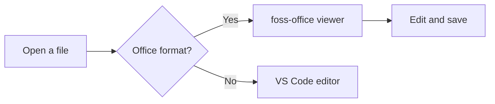

# Release Notes

> [!TIP] What's new
> The editor now keeps **HTML blocks** and **sized images** exactly as written. See [[Home]] for the rest of the vault.

## Supported Formats

| Viewer       | Formats                    | Mode      |
| ------------ | -------------------------- | --------- |
| Markdown     | `.md`, `.markdown`         | Edit      |
| Spreadsheet  | `.xlsx`, `.ods`, `.csv`    | Edit      |
| Presentation | `.pptx`, `.ppsx`           | Read-only |

## Checklist

- [x] Open every format inside VS Code
- [x] Follow the VS Code theme
- [ ] Try the sample files in `test/`

## Code

```typescript
export function activate(context: vscode.ExtensionContext) {
    const provider = new OfficeViewerProvider(context);
    context.subscriptions.push(provider.register());
}
```

## Math

The area of a circle is $A = \pi r^2$, and

$$
\sum_{n=1}^{\infty} \frac{1}{n^2} = \frac{\pi^2}{6}
$$

## Diagram


